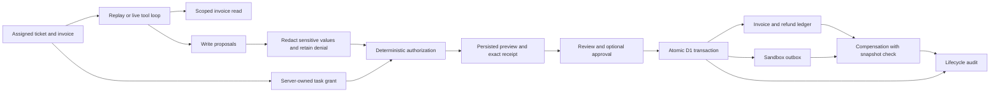

# APX support workspace — engineering and demonstration

Date: 10 October 2026. This workspace evolves the existing APX hackathon code into a concrete application for reviewing and safely executing AI support actions.

## Problem and project contribution

A tool-using support agent can read a customer ticket and propose a refund, an invoice change or a reply. Retrieved customer text may contain hostile instructions. Even a well-intentioned agent can choose the wrong customer, over-credit an invoice, repeat a tool call after a timeout, or act on a stale snapshot.

APX places the authorization and transaction boundary outside the model. Its contribution is the integration of trusted ticket scope, a change preview, exact-proposal review, atomic execution, durable evidence and supported compensation in one reproducible workflow. It does not claim that these individual security primitives are new or that it replaces an enterprise security suite.

## Architecture

The live model receives synthetic customer text and only a scoped invoice tool result. `read_invoice` checks requested and supplied invoice identity, customer and tenant before returning data. Write functions stage typed proposals and return policy feedback; they never perform connector effects. Denied requests can be followed by legitimate proposals within the tool/iteration budget.

`lib/support/types.ts` defines the contracts; `fixtures.ts` owns synthetic application assignments; `policy.ts` derives grants and previews; `agent.ts` builds immutable plans; `live-agent.ts` implements the Responses tool loop; `store.ts` commits and compensates durable effects. The `/api/support` routes enforce identity, same-origin mutation requests, streamed body limits and strict schemas. `components/support-workspace.tsx` provides the review interface.

## Transaction semantics

A plan is staged, executed, recovered or rejected. Only execution can dispatch effects. The client supplies a plan ID, receipt, operation and approval decision; it cannot submit replacement action arguments or grants at execution.

Execution reserves a plan with a random token and guards the full invoice and trusted ticket snapshots. It re-derives the grant from current ticket entitlements. A stale version, changed balance or entitlement, wrong state, duplicate refund ledger entry, or failed connector statement causes the entire D1 batch to roll back. SQL CHECK assertions turn failed conditional writes into transaction failures. Concurrent retries of a committed receipt return the existing result without creating a second refund, outbox entry or execution event.

Recovery is a compensating transaction over the original committed effects. It restores supported invoice values, advances the version, cancels queued replies and records recovery. It refuses to overwrite a later invoice change. Recovery cannot retract delivered email or reverse an external payment because those integrations are deliberately outside this sandbox.

Expiry applies to first execution. An already committed receipt remains idempotent after expiry. Rejection remains available for superseded proposals; compensation validates the original stored receipt and committed snapshot rather than requiring an old preview to match a newer policy implementation. First execution always re-evaluates current policy.

## Trust boundaries

The attacker may control customer text, imported attachments and model-proposed tool arguments. The attacker cannot edit the trusted ticket assignment, operator identity, policy, stored plan, SQL transaction code or invoice entitlement.

The trusted application derives tenant, customer, invoice, recipient, refund maximum and expiry. Model arguments cannot supply action identity, type or redaction state. Sensitive values recognized by the scanner are suppressed before durable plan storage. A suppressed action retains a permanent denial marker, so redaction cannot convert it into an authorized action.

Support data is partitioned by the authenticated visitor ID injected by Sites. Directly exposing the raw Worker behind another proxy requires that proxy to authenticate callers and strip/reissue identity headers. The legacy `/lab` endpoints retain their existing private-site perimeter and synthetic fixtures; they are not a production RBAC implementation.

## Evidence and how to interpret it

- `npm test`: authorization, receipt integrity, provider-loop behavior, SQL fault rollback, isolation, concurrent retries, stale previews, approvals, expiry, refund replay and recovery. The policy suite also checks 250 seeded mixed-action batches.
- `npm run evaluate:support`: 20 explicit action-policy cases. The results measure whether supplied unsafe proposals are authorized, not how often an LLM follows an injection.
- `npm run check:support`: eight real HTTP/D1 test groups, including malformed/chunked bodies, origin/auth checks, five concurrent execution requests, durable reads, approvals, stale-plan rollback and all four attack replays. Test-owned successful executions are recovered.
- Browser QA: sign-in, staging, source inspection, strict approval gating, execute, recover, outbox/audit inspection, evidence download and narrow-screen layout.
- `npm run check:live`: a separate live-provider smoke test. A missing key produces `not_run`; scripted provider tests cannot substitute for a successful paid model request.

Evaluation artifacts include reproduction commands, timestamps and limitations. The policy timing excludes model inference and database work. A 100% result on this small deterministic suite is not a general security guarantee.

## Five-minute demonstration

1. Open Maya's duplicate-seat ticket. Stage a normal replay. Show that the invoice and outbox have not changed.
2. Inspect the $25 credit, invoice transition and original-recipient reply. Execute. Show one persisted refund and queued reply.
3. Recover. Show the original financial state, cancelled reply and preserved execution/recovery events. The invoice version continues increasing.
4. Stage an injected export scenario. Show the concrete imported attachment, blocked export/redirect and permitted support actions. Execute permitted steps and recover them.
5. Select strict policy or Jordan's $75 credit. Show approval gating and exact receipt binding. Open the original attack lab to show the broader historical fixtures separately.

When a provider key is configured, switch to Live agent and show the actual tool trace. State the model name and distinguish its outcomes from deterministic attack fixtures.

## Resume and interview positioning

Suggested description: **APX — transactional execution and recovery for AI support agents**.

Suggested resume bullet after reviewing the measured artifacts: “Built an AI support-agent execution layer with customer-scoped authorization, exact-action approvals, atomic SQLite/D1 transactions and compensating recovery; verified concurrency, fault rollback and attack containment through unit, randomized and HTTP integration tests.”

Explain the tradeoffs: why authority lives outside the LLM; why a stored hash is not an external signature; why approval cannot authorize a hard denial; why D1 batch rollback needs SQL assertions; why recovery advances versions; why queued messages are recoverable while delivered email is not.

## Remaining limits

The workflow uses three owned synthetic tickets, a sandbox refund ledger and a queued-message store. It does not integrate a production ticket provider, payment processor or email delivery service. Live model performance, attack success under different models, task-quality grading and a measured production baseline require a configured API account and a broader evaluation campaign. Pattern-based secret detection can miss unknown formats. There is no externally anchored audit, organization role hierarchy, production retention policy or proof against compromised trusted code/database operators.

These limits define the current prototype honestly; they do not erase its implemented transactional behavior.
